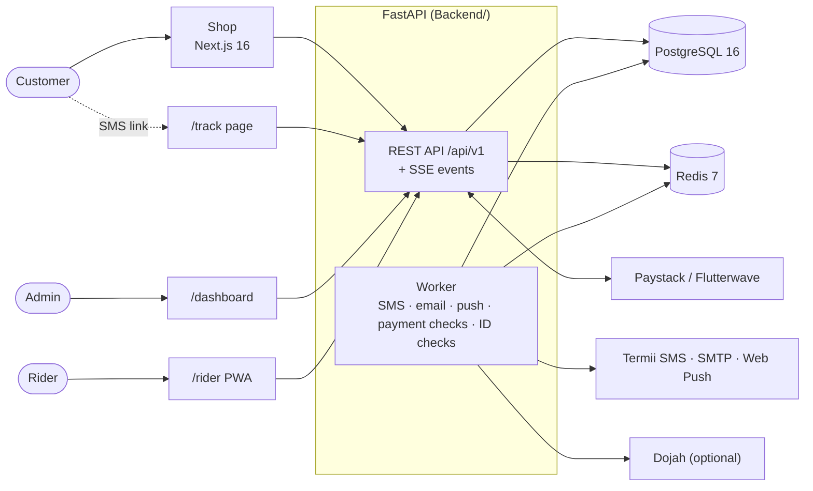

<p align="center">
  
</p>

<h1 align="center">Cheapmarketdeal</h1>

<p align="center">
  An online grocery and fresh-produce store with same-day delivery: a customer shop, an admin dashboard, a rider app and live order tracking, all on one API.
</p>

<p align="center">
  <a href="https://github.com/Abigail56/cheapmarketdeal-api/actions/workflows/ci.yml"></a>
  
  
  
  
  
</p>

---

## What's in it

| App | Who uses it | Where | What it does |
|---|---|---|---|
| **Shop** | Customers | `Frontend/` (Next.js) | Browse and search products, cart (guest or signed in), checkout with card, bank transfer or pay on delivery, coupons, order history, saved addresses, Google sign-in |
| **Admin dashboard** | Store staff | `/dashboard` (served by the API) | New-order alarm, confirm orders, assign riders, live rider map, products, prices and discounts, categories, delivery areas, coupons, riders, rider applications, audit log |
| **Rider app** | Delivery riders | `/rider/` (installable PWA) | Delivery offers with a 5-minute accept window, address check, navigation, live GPS, delivery photo and customer delivery code, push alerts |
| **Order tracking** | Customers | `/track/<token>` | Link sent by SMS: order progress, rider live on a map with ETA, call the rider, fix the delivery pin |

### Highlights

- **Money is computed on the server only.** Totals, delivery fees and discounts are recalculated at checkout, product rows are locked so two people can't buy the last item, and payment webhooks are signature-checked and amount-checked.
- **Payments:** Paystack or Flutterwave cards, bank transfer, and cash on delivery. If a card webhook never arrives, a background job asks the gateway directly.
- **Delivery handover can't be faked.** The customer gets a one-time code by SMS that no API returns, the rider must be within range of the confirmed pin, and a photo is required.
- **Rider vetting:** riders apply in the app with ID documents. Optional NIN lookup and face match through Dojah. ID photos are stored privately and every view is audited.
- **Live everywhere:** server-sent events over Redis Streams keep the dashboard, rider app and tracking page in sync. Riders also get web push, which works with the app closed.
- **Built to run unattended:** a JSON request log with request ids, Sentry, an audit log of every admin change, daily database backups, and a shop that keeps selling if Redis goes down.

## Architecture



In production, **Caddy** sits in front of everything and provides automatic HTTPS for the API domain and the shop domain. Only Caddy is reachable from the internet.

## Tech stack

| Layer | Tools |
|---|---|
| API | Python 3.12, FastAPI, SQLModel / SQLAlchemy (async), asyncpg, Alembic, pydantic-settings |
| Data | PostgreSQL 16 (all records, carts, private ID documents), Redis 7 (cache, rate limits, tokens, queues, event streams) |
| Auth | JWT access and refresh tokens with rotation, Argon2 password hashes, Google sign-in |
| Shop | Next.js 16 (App Router), React 19, Tailwind CSS 4, TypeScript |
| Dashboard and rider app | Plain HTML, CSS and JavaScript served by the API (no build step) |
| Tooling | uv, Ruff, pytest, ESLint, Docker Compose, GitHub Actions |

## Repository layout

```text
.
├── Backend/                  FastAPI service (README: API, flows, deployment)
│   ├── app/
│   │   ├── api/              HTTP routes (v1 endpoints, admin, HTML pages)
│   │   ├── services/         business rules (orders, payments, delivery, pricing…)
│   │   ├── repositories/     database queries
│   │   ├── models/           tables
│   │   ├── schemas/          request and response models
│   │   ├── web/              admin dashboard, rider PWA, tracking page
│   │   └── worker.py         background jobs
│   ├── migrations/           Alembic migrations
│   ├── scripts/              seed data, backups, VAPID keys
│   ├── tests/                pytest suite (real Postgres + Redis)
│   ├── docker-compose.yml        development
│   └── docker-compose.prod.yml   production (API, shop, Caddy, backups)
├── Frontend/                 Next.js customer shop (README: pages, how it works)
├── docs/                     credits for the product photos
└── .github/workflows/ci.yml  lint, migrations, tests, builds
```

## Getting started

**You need:** Docker with Docker Compose, Node.js 22 and npm. You also need [uv](https://docs.astral.sh/uv/) to run the API tests outside Docker.

### 1. Start the API

```bash
cd Backend
cp .env.example .env
python -c "import secrets; print(secrets.token_urlsafe(48))"   # paste the output as SECRET_KEY in .env
mkdir -p backups media

docker compose up --build                          # Postgres, Redis, migrations, API, worker, backups
docker compose exec api python -m scripts.seed     # sample products, delivery zones, a coupon, the admin user
```

| URL | What |
|---|---|
| http://localhost:8000/docs | Interactive API docs (Swagger) |
| http://localhost:8000/dashboard | Admin dashboard: sign in with `ADMIN_EMAIL` / `ADMIN_PASSWORD` from `.env` |
| http://localhost:8000/rider/ | Rider app: demo rider `rider@example.com` / `Rider12345!` (local only) |
| http://localhost:8000/health | Health check |

To use a different port, set `API_HOST_PORT` (and `PUBLIC_BASE_URL`) in `Backend/.env`. Until an SMS or email provider is set up, text messages and emails are printed to the worker log: `docker compose logs -f worker`.

### 2. Start the shop

```bash
cd Frontend
cp .env.example .env.local    # NEXT_PUBLIC_API_URL=http://localhost:8000
npm install
npm run dev                   # http://localhost:3020
```

The backend's `.env` already allows `http://localhost:3020` in `CORS_ORIGINS` and `FRONTEND_URL`. Without payment keys, card checkout goes to a local test payment page (`/mock-pay`). That page is turned off in production.

## Configuration

Each app is configured through its own example file, with every setting explained there:

- `Backend/.env.example`: local development
- `Backend/.env.production.example`: the server (values marked **REQUIRED** must be filled in)
- `Frontend/.env.example`: the shop (`NEXT_PUBLIC_*` values are built into the browser code)

The main optional integrations, which are all off until you add keys:

| Feature | Settings |
|---|---|
| Card payments | `PAYSTACK_SECRET_KEY` or the Flutterwave keys, plus `NEXT_PUBLIC_PAYMENT_PROVIDER` in the shop |
| SMS | `SMS_BACKEND=termii`, `TERMII_API_KEY`, `TERMII_SENDER_ID` |
| Email | `EMAIL_BACKEND=smtp`, `SMTP_*` |
| Google sign-in | `GOOGLE_CLIENT_ID` |
| Rider push alerts | VAPID keys from `python -m scripts.vapid_keys` |
| ID verification | `ID_VERIFY_PROVIDER=dojah` and its keys |
| Image hosting | `STORAGE_BACKEND=cloudinary` (default: local `media` volume) |
| Error tracking | `SENTRY_DSN` |
| New-order alerts by SMS/email | `ADMIN_ALERT_PHONES`, `ADMIN_ALERT_EMAILS` |

## Tests and checks

```bash
# API: uses a separate cmd_test database and Redis DB 15
cd Backend
docker compose up -d db redis
docker compose exec db psql -U $POSTGRES_USER -c "CREATE DATABASE cmd_test;"
uv sync
uv run ruff check .
uv run pytest

# Shop
cd Frontend
npm run lint
npx next typegen && npx tsc --noEmit
npm run build
```

[CI](.github/workflows/ci.yml) runs on every push to `main` and on every pull request. It lints both apps, checks that the migrations apply and match the models, runs the API test suite against real PostgreSQL and Redis, type-checks and builds the shop, and builds both Docker images.

## Deploying

Production runs from `Backend/docker-compose.prod.yml`: API, worker, shop, PostgreSQL, Redis, daily backups and Caddy with automatic HTTPS.

```bash
# On the server, with DNS A records for both domains (e.g. api.example.com and example.com)
git clone https://github.com/Abigail56/cheapmarketdeal-api.git
cd cheapmarketdeal-api/Backend
cp .env.production.example .env       # fill in every REQUIRED value
mkdir -p backups
docker compose -f docker-compose.prod.yml up -d --build
docker compose -f docker-compose.prod.yml exec api python -m scripts.seed   # first admin
```

The API refuses to start in production with a weak `SECRET_KEY`, `DEBUG` turned on, a non-HTTPS `PUBLIC_BASE_URL` or no Redis password. The full checklist (live payment keys, webhook URLs, SMS sender ID, backups kept off the server) is in [Backend/README.md](Backend/README.md#deploying-production).

## Documentation

| Read | For |
|---|---|
| [Backend/README.md](Backend/README.md) | Every API endpoint, the order lifecycle, the delivery journey and its safeguards, riders and ID checks, notifications, backups and restore, deployment |
| [Frontend/README.md](Frontend/README.md) | Shop pages, guest carts, how prices and tokens are handled, testing on a phone |
| `/docs` on a running API | Live, interactive API reference |

## Roadmap

- Automated refunds
- WhatsApp order updates
